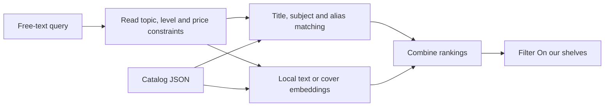

# How this book search learns

The shipped website runs entirely in React and browser workers. It does not call Qwen or OpenAI. Training and dataset preparation happen separately on the development machine.

## What changed

The catalog now stores subjects, aliases, a reading level when the title establishes one, and an AI-generated cover description. Unclear reading levels stay `unspecified`. Generated cover descriptions are editable and may contain mistakes; check them against the image when a visual search is wrong.

Exact titles, subjects, topic names, abbreviations, and a limited one-edit spelling correction provide lexical matches. The text worker adds MiniLM semantic candidates. Cover queries search saved descriptions and can also use CLIP image embeddings. Rankings are combined using reciprocal rank fusion; their incompatible numerical scales are not treated as confidence percentages.

The initial semantic candidate floors are 0.5 for text and 0.25 for covers. These are tunable retrieval parameters, not universal relevance guarantees. Exact metadata matches do not need to exceed those cosine scores. All eligible matches filter the existing shelf grid; there is no three-book display limit. Topic chips intersect with the search, and clearing the search preserves the selected topics.

Prices are deterministic constraints from `price` and `currency` in the JSON. A high semantic score cannot override a price limit.

## Indexing is different from training

**Indexing:** the pretrained MiniLM or CLIP model converts each catalog item into a vector. No model weights change. The browser caches those vectors. Editing the indexed data changes its cache key and causes re-indexing.

**Teacher data generation:** local Qwen proposes search queries or describes cover images. This creates data; it changes neither Qwen's weights nor MiniLM's weights.

**Supervised training:** labeled examples change a model's numerical parameters. The earlier `train:search` experiment trained a small Naive Bayes topic classifier. That artifact is retained for experiments and is not used as proof that a book is relevant.

**Retrieval tuning:** adjusting matching rules, fields, ranking weights, and candidate cutoffs can improve retrieval without retraining a transformer. Measure these changes against reviewed query/book labels.

## Our local/assistant workflow

1. Local Qwen generated 36 book-specific candidate queries, with positive book IDs.
2. The assistant checked the labels against the catalog descriptions. Thirty-three were accepted; three were rejected for an exact-title shortcut or unsupported audience/diet claims.
3. Accepted examples are in `rag/training/retrieval-train.json`; rejected examples retain reasons in `rag/training/retrieval-rejected.json`.
4. A separate assistant-authored 26-case regression set is in `rag/training/retrieval-eval.json`. It includes math, JavaScript abbreviations, flowers, spelling, authors, reading levels, cover descriptions, price rules, and no-match cases.
5. `npm run test:search:hybrid` writes the report. Hit@3 asks whether at least one labeled relevant book appears among the first three. Precision@3 counts the proportion of displayed top-three results that are labeled relevant. Constraint failures count price/topic violations.

These are small synthetic regression sets, not evidence of broad real-user accuracy. Repeatedly editing the algorithm after inspecting this set makes it a development set, not an untouched test set. Add new user queries and keep a new, unseen test set before claiming general improvement.

## How to fine-tune embedding weights locally

This is a future experiment; no transformer fine-tuning job was started.

1. Collect many reviewed `(query, relevant book, irrelevant book)` examples. Use the JSON IDs, never guessed titles. Include hard negatives: for “beginner algebra,” an advanced algebra book is more useful than a random cookbook.
2. Split by query family so near-identical paraphrases do not appear in training and testing. Keep the final test set untouched.
3. Start from the existing small text embedding model. Use Sentence Transformers training tools with a contrastive loss such as Multiple Negatives Ranking Loss or a triplet loss. Only use a GPU if it is available and fits the model; this preparation does not install a training stack or assume a particular GPU.
4. Compare the fine-tuned model with the original on recall/hit rate, precision, no-match behavior, and hard price/topic constraints. Reject a model that improves training metrics but worsens the test set.
5. Export the winning encoder to ONNX, quantize it, and verify its tokenizer, pooling, normalization, and output dimensions in Transformers.js. Rebuild every catalog embedding with that same model and version the cache key. Never mix vectors from different encoders.

Fine-tuning Qwen for structured query parsing would be a separate project. It would require examples whose desired output is a JSON intent object. It does not automatically improve MiniLM embeddings and would not make a large Qwen model lightweight enough for this browser UI.

## OpenAI's role

The assistant can review examples and help write/evaluate code in this chat. That does not require a separate OpenAI API request or grant free API credits. No OpenAI API credentials or billed training jobs were used here.

OpenAI's official pricing page currently says its fine-tuning platform is winding down and is not accessible to new fine-tuning users. Do not assume a new hosted fine-tuning job is available for an account.

## Read more

- [Sentence Transformers: semantic search](https://www.sbert.net/examples/sentence_transformer/applications/semantic-search/README.html)
- [Sentence Transformers: retrieve and rerank](https://www.sbert.net/examples/sentence_transformer/applications/retrieve_rerank/README.html)
- [OpenAI: supervised fine-tuning](https://developers.openai.com/api/docs/guides/supervised-fine-tuning)
- [OpenAI: current pricing and fine-tuning availability](https://developers.openai.com/api/docs/pricing)
